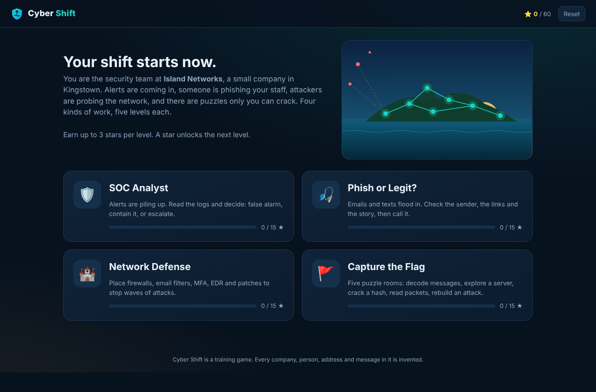
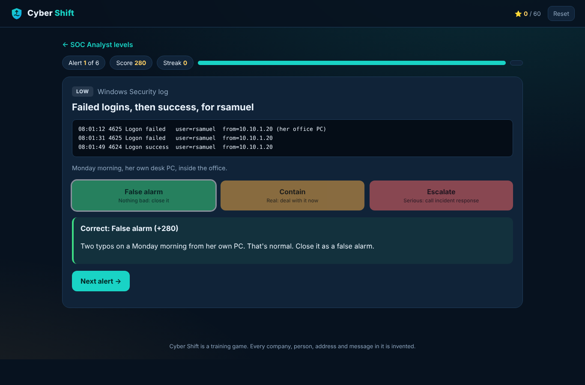
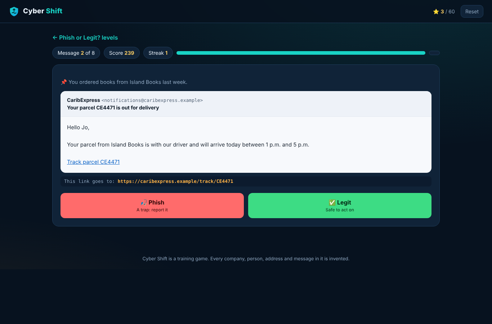
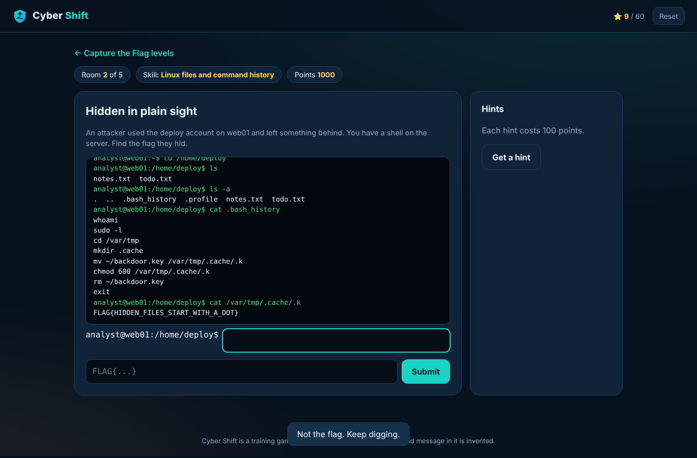

# Cyber Shift: Defend the Island

**A cybersecurity game in four modes and 20 levels.** You're the security team at Island Networks, a small company in Kingstown, St. Vincent. Triage alerts like a SOC analyst, spot phishing, defend the network, and solve capture-the-flag puzzles. Each mode teaches real skills, and every answer comes with an explanation.

**[Play it](https://jody2905.github.io/cyber-shift/)**. It runs in any browser, on desktop or phone, with nothing to install.



## The four modes

### 🛡️ SOC Analyst
Alerts arrive with real-looking logs and context. Decide before the timer runs out: **false alarm**, **contain** (a real problem you can handle now) or **escalate** (a confirmed break-in, data leaving, ransomware). 34 alerts across five shifts, from brute-force attempts and backup jobs to MFA fatigue, Kerberoasting, credential dumping and business email compromise.



### 🎣 Phish or Legit?
40 emails and texts. Hover over or tap a link to see where it really goes, check the sender and the story, then decide. The levels move from prize scams to expert tricks: lookalike domains, links whose text differs from where they go, hacked colleagues, Reply-To mismatches, QR-code phishing, foreign letters that look identical, and fake app-permission requests.



### 🏰 Network Defense
A tower-defense game where each defense works like the real thing: firewalls stop scans and DDoS floods, email filters stop phishing, MFA stops password attacks, EDR stops malware and ransomware, and patching stops exploits. Each does full damage only to the threats it's made for, so you have to read the threat briefing and build the right mix. Five maps, ending with a ransomware gang.

### 🚩 Capture the Flag
Five hands-on puzzle rooms, each teaching one skill:

| Room | You use | You learn |
|---|---|---|
| The postcard | A decoder bench (Base64, Caesar, ROT13, hex) | Encoding isn't encryption |
| Hidden in plain sight | A working Linux terminal (ls -a, cd, cat, find, history) | Hidden files and command history |
| Weak password | A SHA-256 cracking bench and a wordlist | Why “Name + year + !” falls to a guess |
| Packet capture | A Wireshark-style viewer with filters | Why HTTP leaks passwords and HTTPS doesn't |
| Incident timeline | Server logs | Rebuilding an attack: entry, account, backdoor |



## Scoring

Every level awards up to three stars, and one star unlocks the next level. Progress is saved in your browser. The quiz modes reward accuracy, speed and streaks. Network Defense rewards the data integrity you keep, and Capture the Flag rewards solving without hints.

## Built with

Plain HTML, CSS and JavaScript, with no frameworks or libraries, so it loads fast and runs from GitHub Pages or straight from the folder. The tower defense draws on an HTML canvas. The password room includes its own SHA-256 implementation (checked against Node's crypto module), and every piece of message and log text is escaped before it's shown.

```
index.html         the page
css/style.css      the look
js/core.js         hub, levels, stars, saved progress, results
js/soc.js          SOC Analyst          js/soc-data.js     its 34 alerts
js/phish.js        Phish or Legit       js/phish-data.js   its 40 messages
js/defense.js      Network Defense (canvas)
js/ctf.js          Capture the Flag rooms
```

To run it locally, open `index.html` in a browser.

## Note

Island Networks, Windward Bank, IslandTel, CaribExpress, CloudDesk and everyone else in the game are invented. Web addresses use the reserved `.example` domain, and IP addresses come from the ranges set aside for documentation.

## License

MIT
